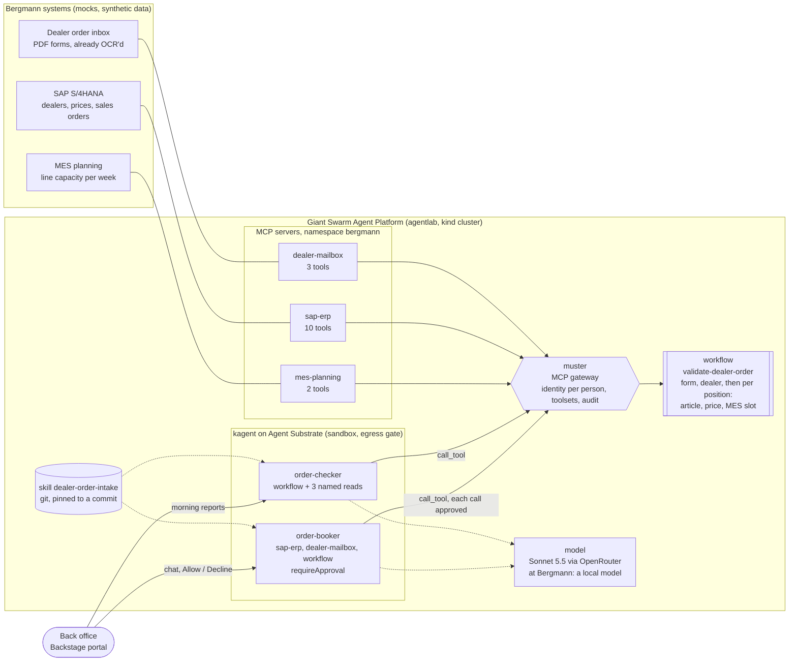

# Bergmann dealer order intake on the Giant Swarm Agent Platform

A working agentic workflow for a fictional customer, **Bergmann Kitchen Systems**,
built on the [Giant Swarm Agent Platform](https://github.com/giantswarm/agent-platform)
running locally with [agentlab](https://github.com/giantswarm/agentlab).

**The outcome it moves:** on-time delivery to dealers (Bergmann Pro: 87 % today,
target 95 %). Smaller dealers send PDF order forms by email; two back-office clerks
retype them into SAP; entry errors are the most common cause of late Pro deliveries.
Roughly one in three forms carries an error that is found only after the order is
already in SAP.

**What the agents do:** every morning, a read-only agent checks each new order
form against SAP (dealer, articles, prices, pack sizes) and the MES (earliest
production slot) and writes one check report per order with a verdict. A second
agent books an approved order into SAP, every step waiting for a person's OK.
Nothing is typed by hand; nothing is written without a human in the loop.

All customer systems and data are **mocks with synthetic data**.

## How it fits together



Each agent is one HelmRelease of the Giant Swarm `agent` chart, delivered by Flux and admitted by Kyverno. Every tool call goes through muster as the signed-in person.

| Layer | What | Where |
|---|---|---|
| Customer systems | three FastMCP servers, one file, `SYSTEM=mailbox\|sap\|mes` | `mocks/server.py`, `mocks/data/` |
| Registration | `MCPServer` resources, tools appear as `x_sap-erp_*`, `x_dealer-mailbox_*`, `x_mes-planning_*` | `platform/mcpservers.yaml` |
| Workflow | `validate-dealer-order`: form → dealer → per position: article, price, MES slot | `platform/workflow.yaml` |
| Skill | the five checks, four verdicts, report format | `skills/dealer-order-intake/SKILL.md` |
| Agents | two HelmReleases of the Giant Swarm `agent` chart, delivered by Flux; the checker gets four named tools | `platform/agents/` |
| Phase two | `home-returns-triage` skill (Induct 80 returns), not used in the demo | `skills/home-returns-triage/` |

## The four demo orders

| Email | Dealer | What the form carries | Verdict |
|---|---|---|---|
| E-…-001 | Küchenprofi Hamburg | everything correct | BOOK |
| E-…-002 | Ristoratore Forniture (IT) | `BP-COMBI-10G` (hyphen missing), 2025 prices, qty 12 of a pack of 10 | BOOK WITH NOTICE |
| E-…-003 | Gastro Nord (SE) | requested week 46, line 2 is full until week 47, hotel opens 20 Nov | BOOK WITH NOTICE |
| E-…-004 | Horeca Supplies (NL) | dealer number of another dealer, article `BP-RANGE-8-G` does not exist | ASK DEALER |

## Run it

Prerequisites: a machine with Docker (4 CPU / 6 GiB minimum, 8 / 16 is comfortable),
[agentlab](https://github.com/giantswarm/agentlab/releases), `kubectl`, a model API key.
Built and tested on agentlab v0.119.0, agent-platform chart 4.154.2, agent chart 2.2.3.

```bash
# 1. the platform (15–25 min on a 4 vCPU box)
mkdir lab && cd lab
agentlab configure --defaults
# add a model the agents can use (OpenRouter shown; Anthropic works with ANTHROPIC_API_KEY)
cat >> agentlab.yaml <<'EOF'
platform:
    extraModels:
        - name: sonnet
          provider: OpenAI
          model: anthropic/claude-sonnet-5.5
          baseUrl: https://openrouter.ai/api/v1
          apiKeyEnv: OPENROUTER_API_KEY
EOF
export OPENROUTER_API_KEY=...
agentlab up
agentlab platform-test

# 2. the demo
export KUBECONFIG=$PWD/state/kubeconfig
git clone https://github.com/VictoryDev0/bergmann-order-intake && cd bergmann-order-intake
GITHUB_OWNER=VictoryDev0 SKILLS_COMMIT=$(git rev-parse HEAD) scripts/deploy.sh --agents

# 3. a turn, headless
cd ../lab
agentlab turn --template order-checker "Check all new dealer order emails and write one check report per order."
agentlab turn --template order-booker --decide approve "Book order email E-2026-10-26-002 into SAP."
```

`scripts/demo.sh` resets the mocks in place (no pod restart), waits for `scripts/prove.sh`
(12 checks) to pass and starts the morning run; `scripts/tunnel.sh` opens the portal from
another machine. Portal users: `admin@lab.local` / `password`.

## What the platform does here that the mocks do not

- **Identity on every call.** Every tool call carries the signed-in person's token; muster logs who called what.
- **Toolsets only narrow.** `order-checker` declares four named tools (the workflow, two inbox reads, the KPI sheet). `preset:read-only` would have resolved to 66 tools, Kubernetes reads included. A call to `x_sap-erp_create_sales_order` or `x_kubernetes_list` is refused by muster, whatever the model decides.
- **Approval.** `order-booker` runs with `muster.requireApproval: true`: each tool call pauses until a person approves it in the portal.
- **Delivery by GitOps.** An agent is a HelmRelease; the skill is pinned to a git commit; Kyverno enforces the fleet's multi-tenancy policy.
- **Egress.** Agents run in sandboxes that reach only their model, muster and the skill source. The order list cannot be posted anywhere else.
- **Cost.** Model calls go through the platform's agentgateway (`platform/lab/llm-routing.yaml`), so Usage > Cost shows tokens and spend per agent.

## Limitations, honestly

- Synthetic data and three mocks. A real SAP or MES connector is most of a real project.
- The demo model runs at a provider (OpenRouter → Anthropic). At Bergmann the same agent runs against a local model (`extraModels` with an Ollama or llm-d endpoint); the switch is one ModelConfig name on the HelmRelease.
- `requireApproval` pauses on every tool call of the agent, including discovery calls. The agents are told to call tools by exact name to keep approvals meaningful.
- On a 4 vCPU box the platform's own CPU requests are the constraint, not the agents (see `BUILD_LOG.md`).
- The OCR/IDP step (PDF → fields) is assumed; the mailbox mock serves the fields.

See `BUILD_LOG.md` for how it was built, including where AI assistance did the work.
